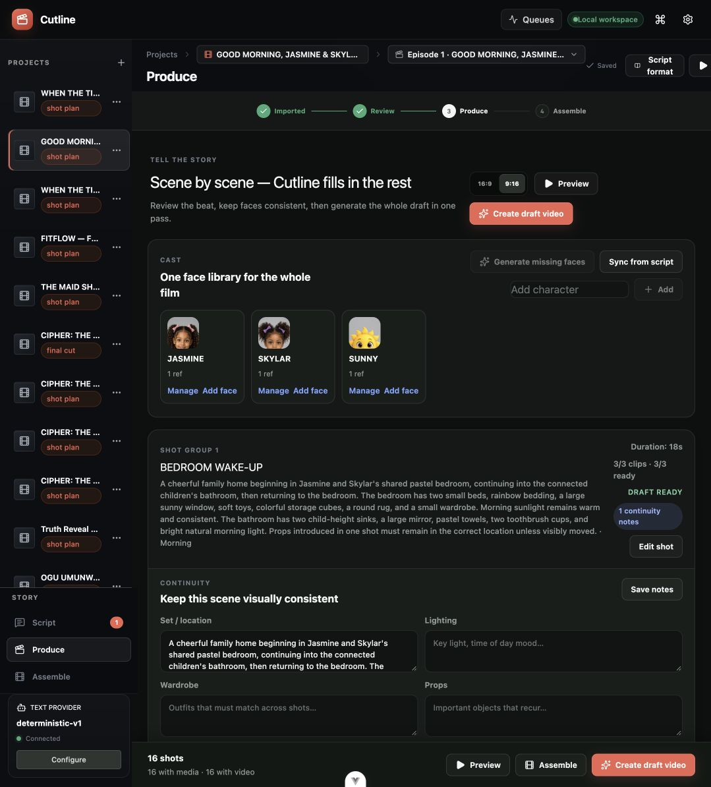

# Cutline Studio

**Experimental local-only alpha.** Local-first movie planning workspace. Import a screenplay, run a structured review, accept or reject proposed fixes, and produce scene-level image and video prompts.



## Stack

- Vue 3, TypeScript, Vite, Pinia
- FastAPI, SQLAlchemy, SQLite
- Huey with a persistent SQLite queue
- Pluggable text providers: built-in prototype parser, Ollama, or an OpenAI-compatible local bridge

Docker is intentionally not required for the prototype. The app database and task queue live in `backend/data/`.

## Run locally

Requires macOS or Linux with Bash, `lsof`, `curl`, Python 3.11+, [uv](https://docs.astral.sh/uv/), and Node.js 24.12+ with npm. Install `ffmpeg` (including `ffprobe`) for video editing, frame extraction, audio processing, and final-cut rendering.

From a fresh clone, start the core local stack:

```sh
./scripts/dev
```

This installs missing Python and frontend dependencies from their lockfiles, then starts FastAPI, all persistent workers, and Vite. Browser bridges are optional and skipped by default; see [bridge configuration](bridges/README.md) before using `./scripts/dev --bridges`. Logs are written under `.runtime/`; Ctrl+C cleanly stops processes started by the launcher.

For individual service development, the equivalent commands are:

```sh
cd frontend
npm ci
npm run dev
```

```sh
cd backend
uv sync --locked
uv run movie-api
```

```sh
cd backend
uv run movie-worker
```

Open [http://127.0.0.1:5173](http://127.0.0.1:5173). The prototype parser is available immediately and does not use API credits.

## Shot plan and images

Approving a script opens the shot-plan workspace. Each shot supports prompt and timing edits, queued image generation, regeneration, manual JPG/PNG/WebP upload, and image deletion. Assets are stored locally in `backend/data/media/`.

Image generation uses `MOVIE_IMAGE_PROVIDERS=chatgpt_web,gemini_web`. Each ChatGPT attempt opens a fresh tab and conversation in the persistent signed-in browser context, records its conversation URL on the job, and closes the tab when complete. The bridge waits for generation progress to clear and a new image to remain stable before returning it; uncertain or timed-out results fail without replacing existing media. ChatGPT is tried once, followed by one Gemini attempt when its Docker bridge is online. Manual upload remains available.

The worker runs separate persistent `chatgpt`, `gemini`, `image`, `general`, and `video` lanes. Browser-backed image work is serialized while unrelated analysis and rendering continue independently. Provider settings distinguish a connected browser session from image generation verified by a successful real request.

## Shot clips and ComfyUI

The Clips workspace stores one local video per shot. MP4, WebM, and MOV files up to 250 MB can be uploaded, replaced, played, or deleted without installing a video model. The project Preview automatically uses a shot video when present and falls back to its storyboard image otherwise.

For shot-to-shot continuity, choose a frame from the immediately previous shot's video in the shot editor. Cutline saves it as a separate starting-frame asset for the selected aspect ratio, without replacing the storyboard image or cast references. Video generation uses that image as the provider's opening frame and asks it to preserve the prior shot's scene; remove or replace the selected frame at any time.

Local generation uses ComfyUI through the dedicated `video` queue. Start ComfyUI on `http://127.0.0.1:8188`, export an image-to-video workflow using **Save (API Format)**, and save it as `backend/data/comfyui_i2v_workflow.json`. See [the ComfyUI workflow guide](docs/COMFYUI_WORKFLOW.md) for the required input placeholders. The Generate video button stays disabled until both the workflow and ComfyUI server are available.

## Final cut

The Final cut workspace assembles the current shot timeline locally with FFmpeg. Existing clips retain their audio; shots without clips use their storyboard image for the planned duration with silence. Every segment is normalized to H.264 video, stereo AAC audio, and the project aspect ratio before being joined into a downloadable MP4. Rendering runs on the persistent `video` queue and reports shot-level progress.

Changing a shot duration or replacing/deleting shot media invalidates the previous master. Rendering again safely replaces the old export while leaving source clips and images intact.

## Ollama

Install Ollama, then download and serve the selected model:

```sh
ollama pull qwen3:8b
ollama serve
```

The API checks `http://127.0.0.1:11434` and enables Ollama in the project form once it responds. Provider settings can be changed in `backend/.env`; copy the available keys from `backend/.env.example`.

## Compatible bridge

The `compatible` provider targets an OpenAI-compatible `/v1/chat/completions` server. This keeps browser-backed Gemini or ChatGPT experiments isolated behind one adapter. Configure its base URL, model, and optional key in `backend/.env`.

Browser-session bridges are experimental and may break when the upstream website changes. Ollama and the built-in parser remain the stable local paths.

## Structured screenplay imports

Screenplays containing explicit `SHOT`, `Time`, `Framing`, `Action`, `Sound`, `Image prompt`, and `Video prompt` sections are parsed deterministically before any model call. Consecutive shots are kept in one sequence by default; optional `Scene:` and shot-level `Location:` fields create compact production groupings. The selected text model reviews the resulting shot plan and returns suggestions only; it cannot remove, merge, or reorder parsed shots. Traditional scene-based screenplays continue through the provider's generative analyzer.

## Checks

```sh
(cd frontend && npm run build && npm run test:unit -- --run && npx --no-install oxlint . && npx --no-install eslint .)
(cd backend && uv run pytest)
python3 scripts/test_dev.py
```

## Optional video and voice providers

The core parser, planning workspace, and manual media uploads work without provider credentials. Copy `backend/.env.example` to `backend/.env` only when configuring integrations; restart the API and workers after changes.

- **Runway video:** set `MOVIE_VIDEO_PROVIDER=runway` and `MOVIE_RUNWAY_API_KEY`. Generation uses a paid external API.
- **ComfyUI video:** set `MOVIE_VIDEO_PROVIDER=comfyui` and follow the [workflow guide](docs/COMFYUI_WORKFLOW.md).
- **FlowKit video:** requires a separately installed, compatible FlowKit service at `MOVIE_FLOWKIT_BASE_URL` (default `http://127.0.0.1:8100/api/flow`). Configure its project and model with `MOVIE_FLOWKIT_PROJECT_ID` and `MOVIE_FLOWKIT_MODEL_FAMILY`. FlowKit is not bundled; the in-app launcher expects `MOVIE_FLOWKIT_ROOT/venv/bin/python` and the `agent.main` module.
- **VibeVoice dialogue:** requires a separate checkout containing `demo/inference_from_file.py` and WAV presets under `demo/voices/`, plus its own model dependencies. Set `MOVIE_VIBEVOICE_ROOT` and `MOVIE_VIBEVOICE_PYTHON` to absolute paths. Model installation and hardware requirements belong to that provider.
- **Hosted voices:** set `MOVIE_ELEVENLABS_API_KEY` or `MOVIE_OPENAI_API_KEY` for the corresponding voice provider. These make paid external requests.

Browser-backed image generation requires separately supplied bridges. A fresh clone has no built-in image generation model; manual image upload remains available.

## Contributing and local data

Run the checks above before submitting a pull request. CI runs the backend suite, frontend build, unit tests, and lint without changing source files. Describe the issue and how you verified the change; avoid unrelated formatting.

Cutline runs on localhost and is not configured for public server deployment. Keep `.env` files, browser profiles, tokens, generated media, and databases out of commits. Back up `backend/data/` before upgrades; preserve its `.token_key` alongside the database to retain access to encrypted social tokens. Third-party models, bridges, and media retain their own licenses.

Cutline's source is available under the [MIT License](LICENSE).

## Demo project

Choose **Load demo project** in an empty workspace or the new-project dialog. The bundled **Good Morning, Jasmine & Skylar!** demo opens directly in Produce with 8 scenes, 16 shots, three cast members, prompts, timings, and continuity notes. It does not call a model or spend credits. Each click creates an independent copy; nothing is loaded automatically.

Media is optional and excluded from the repository. If you have `jasmine-skylar-demo-media.zip`, extract its `demo-media/` folder into `backend/data/` before loading the demo. Cutline copies available frames, clips, and cast references into the new project. Without the package, the planning demo still works and you can upload or generate media yourself. The media package must be distributed separately from the source checkout.
